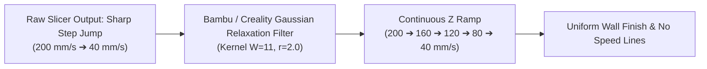

# Smoothing Wall Speed Along Z — OrcaSlicer Plugin

[](https://github.com/persano/orcaslicer-smooth-z-wall-speed/actions/workflows/ci.yml)
[](https://github.com/persano/orcaslicer-smooth-z-wall-speed/releases)
[](LICENSE)
[](https://github.com/OrcaSlicer/OrcaSlicer)

An OrcaSlicer Python plugin bringing Bambu Studio and Creality Print 5's **"Smoothing Wall Speed Along Z"** (`z_direction_outwall_speed_continuous`) feature to OrcaSlicer.

---

## Simple vs Advanced Mode

In Bambu Studio and Creality Print, this feature is a single checkbox with no tunable parameters. This plugin provides both:

1. **Simple Mode (Default — Zero Config)**:
   - Exactly matches Bambu Studio and Creality Print (`libslic3r/GCode/Smoothing.cpp`).
   - Uses the hardcoded iterative 1D Gaussian kernel relaxation ($W=11, r=2.0$, stop threshold $5.0\text{ mm/s}$).
   - No settings to adjust: just enable and slice.

2. **Advanced Mode**:
   - Set `"mode": "advanced"` in Plugin Configuration.
   - Fine-tune Gaussian standard deviation `gaussian_radius`, kernel window `gaussian_window_size`, and convergence threshold `gaussian_stop_threshold_mm_s`.
   - Or switch to linear gradient ramp limiting (`"smoothing_algorithm": "gradient"`).

---

## Why This Exists

In 3D slicing, sudden geometry changes (overhangs, small features, cooling layer-time thresholds) force the slicer to abruptly drop outer wall speeds from e.g. 200 mm/s to 40 mm/s.

When outer wall speed changes sharply between adjacent layers:
- **Gloss & Sheen Inconsistency**: Filament (especially Silk PLA, PETG, ABS) appears shiny at slow speeds and matte at fast speeds.
- **Speed Banding / Hull Lines**: Melt zone pressure differences cause horizontal ring artifacts or layer bulging.

Bambu Studio and Creality Print 5 (`CrealityOfficial/CrealityPrint`) implement a dedicated C++ engine algorithm (`libslic3r/GCode/Smoothing.cpp`) to solve this using an iterative 1D Gaussian kernel relaxation, but OrcaSlicer lacks the C++ engine implementation.

This plugin bridges the gap using OrcaSlicer's modern `slicing-pipeline` plugin system. It runs at the G-code post-processing seam (`psGCodePostProcess`), enforcing continuous, gradual speed transitions along the vertical $Z$ axis matching the official C++ slicer behavior.



---

## Features

- **1:1 Match with Bambu Studio & Creality Print 5**: Direct Python implementation of `libslic3r/GCode/Smoothing.cpp` iterative Gaussian filter ($W=11, r=2.0$, stop threshold $5\text{ mm/s}$).
- **Safe Velocity Clamping**: Fast layers are smoothly ramped down towards slow layers. Safe slow speeds on overhangs and small details are never sped up.
- **Preserves Critical Moves**: Inner walls, sparse infill, solid infill, bridges, and travels keep their exact slicer speeds.
- **Spiral Vase Mode Detection**: Automatically bypasses spiral vase prints as intended.
- **First-Layer Safety**: Configurable exclusion of initial layers to protect bed adhesion feedrates.
- **Zero Recompilation**: Installs directly into stock or portable OrcaSlicer builds.

---

## Installation

### Method 1: Manual Zip Install
1. Download `smooth_z_wall_speed_plugin.zip` from [Releases](https://github.com/persano/orcaslicer-smooth-z-wall-speed/releases/latest).
2. Unpack into your OrcaSlicer plugins folder:
   - **Windows**: `%APPDATA%\OrcaSlicer\orca_plugins\smooth_z_wall_speed\`
   - **Linux**: `~/.config/OrcaSlicer/orca_plugins/smooth_z_wall_speed/`
   - **macOS**: `~/Library/Application Support/OrcaSlicer/orca_plugins/smooth_z_wall_speed/`
3. Restart OrcaSlicer.

### Method 2: Python Wheel Install
1. Open OrcaSlicer -> **File** -> **Plugins**.
2. Click **Install from Wheel...** and select `smooth_z_wall_speed-1.1.0-py3-none-any.whl`.
3. Restart OrcaSlicer.

---

## How to Enable in OrcaSlicer

1. In OrcaSlicer, open your **Process** settings.
2. Navigate to **Others** -> **Slicing Pipeline Plugin**.
3. Select **Smoothing Wall Speed Along Z**.
4. Slice your plate and print normally.

---

## Configuration Options

Inside OrcaSlicer (**Process -> Others -> Plugin Configuration**), the following parameters are available:

| Parameter | Default | Description |
|---|---|---|
| `enabled` | `true` | Master toggle for the plugin. |
| `smoothing_mode` | `"gaussian"` | `"gaussian"` (1:1 match with Bambu/Creality C++ algorithm) or `"gradient"` (linear slope). |
| `gaussian_radius` | `2.0` | Gaussian standard deviation radius $r$ (Bambu/Creality default: `2.0`). |
| `gaussian_window_size` | `11` | Gaussian filter window size (Bambu/Creality default: `11`). |
| `gaussian_stop_threshold_mm_s` | `5.0` | Stop convergence threshold between adjacent layers in mm/s (Bambu/Creality default: `5.0`). |
| `max_steps_count` | `1000` | Maximum relaxation iterations. |
| `max_speed_change_per_mm` | `50.0` | Maximum speed change in mm/s per 1 mm Z when in `"gradient"` mode. |
| `min_outer_wall_speed_mm_s` | `10.0` | Floor speed clamp in mm/s. |
| `skip_first_layers` | `1` | Number of initial layers to leave untouched (ensures bed adhesion). |
| `smooth_overhang_layers` | `true` | If true, overhang speed drops are factored into adjacent outer wall speed smoothing. |

---

## CLI Usage (Standalone / Post-Processing Script)

The script can also be executed outside of OrcaSlicer as a standalone post-processing script:

```bash
python smooth_z_wall_speed.py input.gcode -o output.gcode --max-accel-z 50.0 --skip-first 1
```

---

## License

GPL-3.0 License. See [LICENSE](LICENSE) for details.
